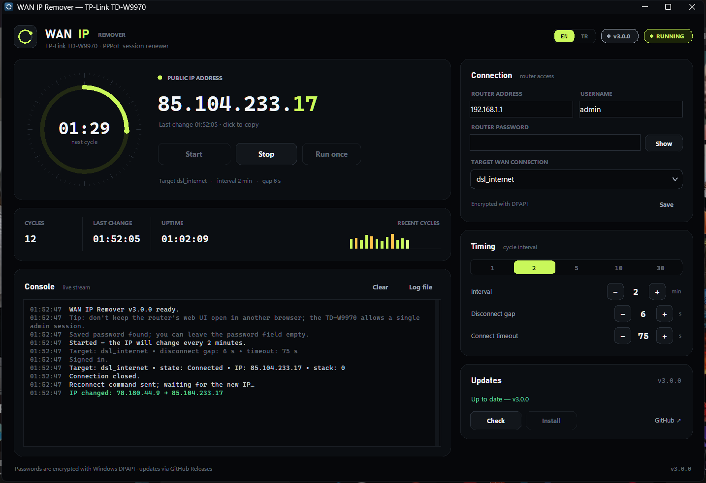
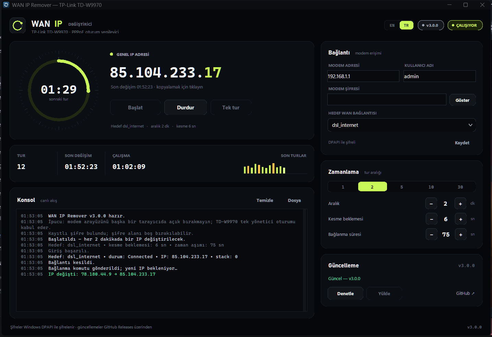

# WAN IP Remover

**Renew your ISP-assigned public IP on a schedule — from a small, good-looking Windows app.**

WAN IP Remover signs in to a TP-Link TD-W9970 router, drops the selected PPPoE WAN
session and brings it straight back up, so the ISP hands out a fresh public IP.
The cycle repeats on your chosen interval (2 minutes by default) and stops the
moment you press **Stop**.

It never touches your DSL username or password — only the live PPPoE session is
renewed.



## Features

- **Orbit UI** — a dark, single-accent interface built with tkinter: orbital
  countdown gauge, click-to-copy IP with the last octet highlighted, cycle
  sparkline and a live console.
- **Crisp on high-DPI screens** — the process is DPI-aware and every dimension is
  scaled, so text stays sharp at 125 %, 150 % and beyond.
- **English and Turkish** — switch language from the header; the choice is saved.
- **Safe by design** — a wrong password stops the app after one attempt instead
  of tripping the router's 5-attempt / 10-minute lockout.
- **Password encrypted at rest** — stored with Windows DPAPI in `config.json`.
- **Self-updating** — checks GitHub Releases, downloads the new build, verifies
  its version and syntax, swaps itself in and restarts. The previous file is kept
  as `.bak`.
- **No dependencies** — Python standard library only, one `.pyw` file.

<details>
<summary>Turkish interface</summary>



</details>

## Requirements

| | |
|---|---|
| OS | Windows 10 or 11 |
| OS | Windows 10 or 11 |
| Python | 3.10+ with tkinter (tested on 3.14) |
| Network | This PC on the same LAN as the router |
| Router | TP-Link TD-W9970 (other TP-Link CGI-based models may work) |
| Access | Router admin username and password |

## Quick start

1. Download the latest **`WAN-IP-Remover-vX.Y.Z.zip`** from
   [Releases](https://github.com/umitsTASCI/wan-ip-remover/releases) and extract it
   anywhere, or clone the repository.
2. Double-click **`Start.bat`** (or the desktop shortcut).
3. Fill in the connection panel:

   | Field | Example | Notes |
   |---|---|---|
   | Router address | `192.168.1.1` | `http://` and a trailing `/` are accepted |
   | Username | `admin` | Router admin user |
   | Router password | •••••• | Encrypted with DPAPI after the first save |
   | Target WAN connection | `dsl_internet` | Use **List** to read the real names |

4. Press **List** once to confirm the WAN connection name and the current IP.
5. Pick an interval and press **Start**.

If the window does not appear, run **`Start_Console.bat`** to see the error.

## Settings

| Setting | Default | Meaning |
|---|---|---|
| Interval | 2 min | Wait after a cycle finishes before the next one |
| Disconnect gap | 6 s | Time the PPPoE session stays down (longer gap → better chance of a new IP) |
| Connect timeout | 75 s | How long to wait for the session to come back with an IP |

The interval, gap and timeout are also editable with the steppers; presets jump
to 1, 2, 5, 10 or 30 minutes.

## How it works

1. `POST /cgi/getParm` fetches the router's RSA public key.
2. The username and base64 password are encrypted with PKCS#1 v1.5 and posted to
   `/cgi/login`; the `JSESSIONID` cookie and `TokenID` header are kept.
3. `POST /cgi?5` returns the `WAN_PPP_CONN` list (`name`, `connectionStatus`,
   `externalIPAddress`, stack id).
4. `POST /cgi?7` sends `ACT_PPP_DISCONN` and, after the gap, `ACT_PPP_CONN`.
5. The WAN list is polled until the connection is `Connected` with a non-zero IP.
   The session is closed with `/cgi/logout`.

The app does not reboot the router; only the PPPoE session is renewed.

## Updates

On launch the app asks GitHub for the latest release and compares it with its own
`APP_VERSION`. **Check** runs the same check on demand. When a newer release is
published, **Install** downloads `wan_ip_remover.pyw`, verifies that it declares
the expected version and compiles, then a small batch file replaces the running
file and restarts the app. The old version stays next to it as
`wan_ip_remover.pyw.bak`.

Because the check is anonymous, the repository must stay public.

## Command line

```bat
python wan_ip_remover.pyw                 :: normal start
python wan_ip_remover.pyw --selftest      :: 37 self checks, no GUI
python wan_ip_remover.pyw --smoke         :: build the UI and exit
python wan_ip_remover.pyw --demo          :: populated UI for screenshots
python wan_ip_remover.pyw --lang=tr       :: force a language for this run
python wan_ip_remover.pyw --no-update-check
```

## Troubleshooting

| Symptom | Fix |
|---|---|
| `Could not reach the router` | Check the address, that the router is on, and that the PC is on the same network. |
| `Wrong username or password` | Use the router admin login, not the DSL/PPPoE credentials. The app stops after one failure to avoid a lockout. |
| `The router rejected the sign-in` | Close the router's web UI in every browser — the TD-W9970 allows a single admin session. |
| `No WAN connection named ...` | Press **List** and copy the exact name (often `dsl_internet`). |
| IP stays the same | Increase the disconnect gap (try 15–30 s). Some ISPs reassign the same lease, and CGNAT addresses cannot change. |
| Timeout waiting for an IP | Check DSL status in the router; the line may be down. |

## Limitations

- Only the PPPoE session is renewed. Static IPs, CGNAT pools and ISPs with long
  DHCP leases may keep returning the same address.
- The UI is Windows-only (DPAPI, Win32 title bar, `startfile`).
- Firmware differences can change the CGI replies; the app reports unexpected
  answers instead of guessing.

## License

[MIT](LICENSE)
